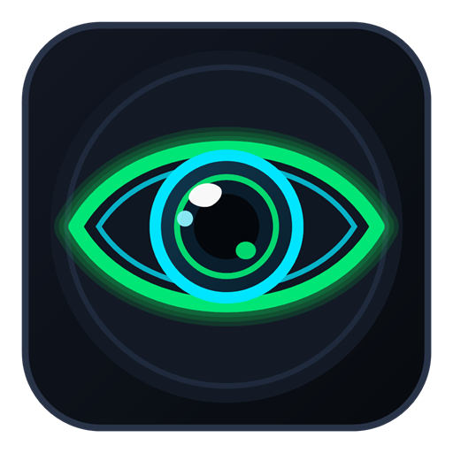

<div align="center">



# EyeCam

**Перетворіть ваш Android-смартфон на швидку 4K веб-камеру для ПК із мінімальною затримкою**

[](https://github.com/Gladiator666Satan/EyeCam/actions/workflows/ci-build.yml)
[](https://github.com/Gladiator666Satan/EyeCam/releases/latest)


[⬇️ Завантажити останню версію](https://github.com/Gladiator666Satan/EyeCam/releases/latest) · [📱 Встановлення Android](#-android) · [🪟 Встановлення Windows](#-windows) · [🐧 Встановлення Linux](#-linux) · [❤️ Підтримати автора](#-підтримка-автора)

</div>

---

## Про застосунок

**EyeCam** дозволяє використовувати камери вашого смартфона як повноцінну системну веб-камеру комп'ютера у **OBS Studio, Zoom, Discord, Microsoft Teams, Google Meet** та браузерах на базі WebRTC.

Застосунок поєднує апаратне кодування H.264 на смартфоні, OpenGL ES рендеринг із підтримкою кольорових профілів **`.cube` 3D LUT** та нативний десктопний приймач **EyeCam Studio**, передаючи картинку по **USB-кабелю** або через локальну мережу **Wi-Fi**.

---

## Основні можливості (v1.4.1)

- **Висока якість і широка сумісність пристроїв** — стрімінг у **4K UHD, 2K QHD, 1080p та 720p (30 / 60 FPS)** на флагманах із інтелектуальним захистом від нагріву, а також повна адаптація під бюджетні та старші смартфони (наприклад, **Redmi 8A** та пристрої рівня `LEGACY`/`LIMITED` із автоматичним підбором безпечного профілю H.264 `30 FPS`).
- **Два режими підключення** — **USB (ADB)** із мінімальною затримкою без потреби в окремому встановленні Android SDK (ADB вже вшитий у Windows-інсталятор) або бездротовий **Wi-Fi (LAN)**.
- **Окремі кнопки фізичних модулів + внутрішній GPU-зум** — вибір конкретного фізичного об'єктива (**`0.5x UW`**, **`1x Main`**, **`Tele`**, **`5x/MC`**, **`Front`**), де кожна кнопка активна лише за наявності відповідного сенсора у смартфоні, а плавний зум працює **суворо всередині обраного модуля** без небажаного авто-перемикання камер при сильному зумі чи фокусуванні.
- **Живі повзунки в режимі AUTO та ручний Pro ISP із замочками (`🔒`)** — у режимі **AUTO** повзунки (**ISO**, **Витримка / Shutter**, **Фокус**, **Баланс білого Kelvin**) самі плавно рухаються в реальному часі та показують поточне значення автоматики камери. При ручному прокручуванні з'являється замочок **`🔒`** (мінімальне положення `0.0` залишається в ручному режимі як фокус на нескінченність `∞`, а клік по замочку повертає параметр у **AUTO**).
- **Фіксація експозиції (`AE Lock`), Ліхтарик (`🔦`) та Точковий Автофокус (`🎯`)** — миттєва фіксація поточної автоекспозиції однією кнопкою, дистанційне увімкнення/вимкнення ліхтарика смартфона (підтримується в тому числі на Xiaomi Redmi 8A; автоматично блокується на фронтальній камері) та автофокус із візуальним підтвердженням.
- **Підтримка кольорових профілів `.cube` 3D LUT** — завантажуйте кінематографічні та студійні `.cube` LUT-файли в реальному часі як на смартфоні, так і в **EyeCam Studio** на ПК (кольорокорекція одразу передається у віртуальну камеру для OBS / Discord / Zoom).
- **Автоматичне сповіщення та встановлення оновлень у 1 клік** — при виході нової версії на GitHub застосунок сам показує компактне сповіщення з кнопками **«Встановити зараз»** (автоматичне завантаження інсталятора/APK із прогресом та запуск оновлення), **«Нагадати пізніше»** та **«Пропустити цю версію»**.

---

## Завантаження (Releases)

Готові файли для всіх платформ публікуються у розділі **[GitHub Releases](https://github.com/Gladiator666Satan/EyeCam/releases/latest)**:

| Платформа | Файл у релізі | Призначення |
| :--- | :--- | :--- |
| **Android** | `EyeCam-v1.4.1-android.apk` | Мобільний додаток для смартфона (Android 8.0+) |
| **Windows (Рекомендовано)** | `EyeCam-Setup-x64.exe` | Автоматичний інсталятор: `EyeCam Studio` + драйвер віртуальної камери + вшитий ADB + правила Firewall |
| **Windows (Portable)** | `EyeCam-Windows-x64-portable.zip` | Портативний архів без інсталяції |
| **Linux x64** | `EyeCam-Linux-x64.tar.gz` | V4L2-рушій (`libEyeCamLinuxSink.a`), утиліта `linux_test`, SDK-заголовки та скрипт налаштування |

---

## Інструкція встановлення

### 📱 Android

**Системні вимоги:** Android **8.0 (API 26)** або новіше.

1. Відкрийте сторінку **[Releases](https://github.com/Gladiator666Satan/EyeCam/releases/latest)** зі смартфона або ПК та завантажте **`EyeCam-v1.4.1-android.apk`**.
2. Встановіть APK на смартфон:
   - Якщо встановлюєте напряму на телефоні — дозвольте системі встановлення програм з цього джерела (браузера або файлового менеджера).
   - Або встановіть із ПК через ADB:
     ```bash
     adb install -r EyeCam-v1.4.1-android.apk
     ```
3. Запустіть **EyeCam** і надайте дозволи на **Камеру**, **Мікрофон** та **Сповіщення** (потрібно для стабільної фонової роботи сервісу).
4. Оберіть спосіб підключення до ПК:
   - **Для підключення по USB (рекомендовано):**
     1. На смартфоні увімкніть **Параметри розробника** (*Налаштування → Про телефон → натисніть 7 разів на «Номер збірки»*).
     2. У розділі **Для розробників** увімкніть **Налагодження по USB (USB Debugging)**.
     3. Підключіть телефон USB-кабелем до ПК і підтвердіть запит *«Дозволити налагодження по USB»* на екрані телефона.
   - **Для підключення по Wi-Fi:**
     1. Підключіть смартфон і ПК до однієї локальної Wi-Fi мережі.
     2. Подивіться IP-адресу вгорі ліворуч на екрані смартфона у додатку **EyeCam** (порт **`8554`**) та натисніть кнопку **▶ (Старт)**.

---

### 🪟 Windows

**Системні вимоги:** Windows **10 / 11 (x64)**.

#### Варіант А — Автоматичний інсталятор (рекомендовано)

1. Завантажте **`EyeCam-Setup-x64.exe`** зі сторінки **[Releases](https://github.com/Gladiator666Satan/EyeCam/releases/latest)**.
   > **Примітка щодо браузера та SmartScreen:** Оскільки open-source бінарники не мають комерційного EV-сертифіката підпису коду, Chrome/Edge або Windows SmartScreen можуть показати попередження про невідомого видавця. Натисніть **«Зберегти»** (у браузері) та **«Детальніше» → «Виконати в будь-якому разі»** (у SmartScreen).
2. Запустіть інсталятор від імені Адміністратора. Він автоматично:
   - встановить **EyeCam Studio** (`EyeCamStudio.exe`);
   - розпакує вбудований міст **`adb.exe`** (окремо встановлювати Android Studio або SDK не потрібно);
   - зареєструє системну віртуальну камеру **`EyeCam Virtual Camera`** (`EyeCamFilter.dll`);
   - налаштує правила Windows Defender Firewall для портів **`TCP 8554`** і **`UDP 8555`**.
3. Запустіть **EyeCam Studio**:
   - Для **USB-режиму**: оберіть вкладку **USB (Кабель)**, виберіть ваш смартфон зі списку та запустіть трансляцію в додатку на телефоні.
   - Для **Wi-Fi-режиму**: оберіть **Wi-Fi (LAN)**, введіть IP-адресу з екрана смартфона та натисніть **▶ Запустити трансляцію**.
4. Відкрийте **OBS Studio, Zoom, Discord, Microsoft Teams** або **Google Meet** та виберіть джерело відео **`EyeCam Virtual Camera`**.

#### Варіант Б — Portable-версія (без інсталяції)

1. Завантажте та розпакуйте **`EyeCam-Windows-x64-portable.zip`** у зручну папку.
2. Запустіть **`EyeCamStudio.exe`**.
3. Щоб сторонні програми бачили камеру **`EyeCam Virtual Camera`**, натисніть у лівій панелі кнопку **«⚡ Зареєструвати камеру в системі»** (або запустіть **`scripts\register_filter.bat`** від імені Адміністратора).

---

### 🐧 Linux

> **Статус Linux-версії:** Для Linux доступний нативний **V4L2 драйверний рушій (`EyeCamLinuxSink`)**, тестовий генератор **`linux_test`** та скрипт ініціалізації пристрою ядра **`v4l2loopback`**. Повноцінний графічний інтерфейс **EyeCam Studio** наразі реалізований для Windows.

1. **Встановіть системні залежності (`v4l2loopback` та утиліти V4L2):**
   - **Ubuntu / Debian:**
     ```bash
     sudo apt update && sudo apt install -y v4l2loopback-dkms v4l-utils
     ```
   - **Fedora:**
     ```bash
     sudo dnf install -y v4l2loopback v4l-utils
     ```
   - **Arch Linux:**
     ```bash
     sudo pacman -S --needed v4l2loopback-dkms v4l-utils
     ```
2. **Завантажте та розпакуйте релізний архів** **`EyeCam-Linux-x64.tar.gz`** зі сторінки **[Releases](https://github.com/Gladiator666Satan/EyeCam/releases/latest)**:
   ```bash
   mkdir -p eyecam-linux && tar -xzf EyeCam-Linux-x64.tar.gz -C eyecam-linux
   cd eyecam-linux
   ```
3. **Ініціалізуйте віртуальну камеру `/dev/video10`:**
   ```bash
   chmod +x scripts/setup_v4l2loopback.sh bin/linux_test
   sudo ./scripts/setup_v4l2loopback.sh
   ```
   Скрипт завантажить модуль ядра `v4l2loopback` із прапорцем **`exclusive_caps=1`** (обов'язково для того, щоб Chromium, Chrome, Google Meet, Zoom та OBS розпізнавали камеру) і створить пристрій **`EyeCam Virtual Camera`** (`/dev/video10`).
4. **Перевірте роботу віртуальної камери:**
   ```bash
   ./bin/linux_test /dev/video10
   ```
   Після запуску пристрій **`EyeCam Virtual Camera`** з'явиться в OBS Studio, VLC, Chromium / Chrome та Zoom.

---

## Вирішення поширених проблем

| Проблема | Рішення |
| :--- | :--- |
| **OBS / Zoom / Discord не бачить камеру на Windows** | Натисніть **«⚡ Зареєструвати камеру в системі»** всередині EyeCam Studio (підтвердіть UAC) або виконайте від Адміністратора `regsvr32 EyeCamFilter.dll`. |
| **Смартфон не визначається в списку USB** | Переконайтеся, що використовується кабель із передачею даних (не лише зарядка), увімкнено **USB Debugging** та підтверджено діалог RSA-ключа на телефоні; у Studio натисніть **«↻ Оновити список USB-пристроїв»**. |
| **Не підключається по Wi-Fi** | Перевірте, що ПК і смартфон в одній підмережі, а у Windows Firewall дозволено вхідний/вихідний трафік на порт `8554` TCP (інсталятор додає це правило автоматично). |
| **Chrome / браузер на Linux не бачить віртуальну камеру** | Переконайтеся, що `v4l2loopback` завантажено з параметром `exclusive_caps=1` через `sudo ./scripts/setup_v4l2loopback.sh`. |

---

## ❤️ Підтримка автора

Якщо **EyeCam** допомагає вам у роботі, навчанні чи стрімінгу, ви можете підтримати подальший розвиток проєкту:

- 🧡 **Patreon:** [patreon.com/cw/Gladiator_Satan](https://www.patreon.com/cw/Gladiator_Satan)
- ☕ **Buy Me a Coffee:** [buymeacoffee.com/gladiator_satan](https://buymeacoffee.com/gladiator_satan)

---

## Для розробників

- **Архітектура системи та протоколи:** дивіться [`ARCHITECTURE.md`](ARCHITECTURE.md).
- **Детальна інструкція зі збірки з вихідного коду:** дивіться [`BUILD_GUIDE.md`](BUILD_GUIDE.md).

Швидка збірка локально:

```bash
# Android APK
./gradlew assembleDebug

# Windows Studio + DirectShow Filter (з Developer Command Prompt for VS 2022)
build_windows.bat Release

# Linux V4L2 Engine
chmod +x build_linux.sh scripts/linux/setup_v4l2loopback.sh
./build_linux.sh Release
```
